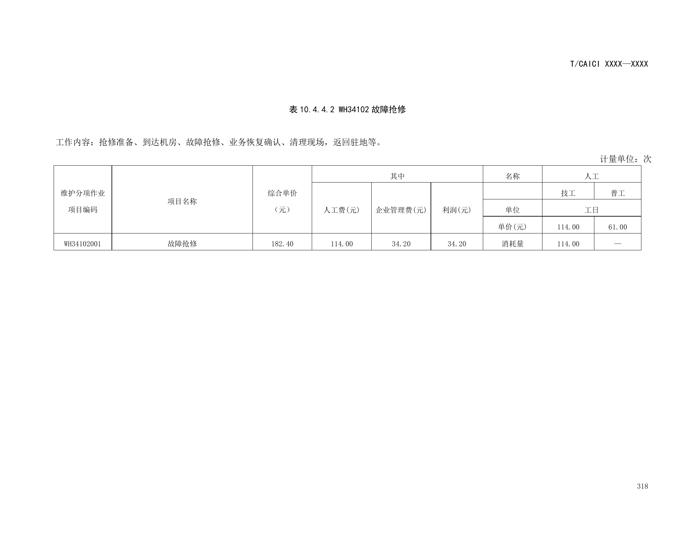

# p6s-0473 原 PDF 表格专项审计

**AI 初步结论：原 PDF 的“消耗量 × 技工”单元格确实印为 114.00；不能把它单纯归因为解析错列。该数与同表人工单价及人工费不相容，业务正确值仍为待核实。不得自动批准 114 工日，也不得自行改为 1 工日。**

本审计只读历史证据，未发模型请求、未重跑检索、未调参、未修改原样本/评分/生产代码。相关 PDF 页面已用 Poppler `pdftoppm` 渲染，并逐张目视核查。人类最终裁决、签字、日期保持空白。

## 输入和原始证据索引

- 原问题：故障抢修的消耗量是多少工日？
- 原 Silver：`p6-silver-e2e-500/silver_cases_500.jsonl` 第 473 行；`question_type=exact_fact`，`reference_answer=114.00工日`；来源 Chunk `6d7a9e41a2a2b736a7746409`，摘录“消耗量 114.00 —”，PDF 页码 324。
- 原运行：`p6-silver-e2e-500/runs/p6-e2e-run-01-qwen-flash/cases/p6s-0473.json`。回答第 1 点为“故障抢修的消耗量为114.00工日/次。[1]”；并补充管道/架空/直埋及天馈故障数值。
- 原评分：`p6-silver-e2e-500/runs/p6-e2e-run-01-qwen-flash/scores/p6s-0473.json`；`answer_correctness.score=null`、`correctness_excluded=true`、`needs_human_review=true`、`flags=[ambiguous_reference]`。该排除状态应保留，不因为这次读到同样数字而解锁。
- 冻结语料：`storage/evaluation/corpus/p1-20261104-v2/corpus.jsonl`，447 Chunk，SHA-256 `5995ee6be2871ee7c553ce5fe2f3002a7938dbffedf0ec2b8fed28af8107f4d6`。
- 本地原 PDF：`data/电信基础设施维护规程.pdf`，6,910,317 字节，字节 SHA-256 `9c8962e69d08275318a4f3c2d3e3ed00b3f06a995a54ddabce4d21d48bd18d58`。
- Chunk 中的 `document_content_hash=8ae9b63d869002c1950aaf1192e44b0b876ccb9d927154f35e8c48bcd24094bb` 是不同口径：当前 `rag_app/ingestion/parsing.py:122` 对 `parsed.text` 做 SHA-256，而非 PDF 字节。因此两者不相等不构成 PDF 漂移证明；也不应冒认已完成历史 PDF 字节版本认证。本次关联依据是同文件名、页码、表号、项目编码、单元格和相邻表内容逐项吻合。

## 第 324 页的行、列、单位与标题

文件物理页码 **324（从 1 开始）**；页面右下角印刷页码 **318**。页眉为 `T/CAICI XXXX—XXXX`，本页标题为 **表 10.4.4.2 WH34102 故障抢修**。

工作内容：“抢修准备、到达机房、故障抢修、业务恢复确认、清理现场，返回驻地等。”表外右上角计量单位为 **次**。上一物理页 323 的章节标题为 **10.4.4 小型局站有线设备其他维护项目综合单价指标**，因此这一表的专业范围是小型局站有线设备；不是所有故障类别统一工日。

| 所在位置 | 目视原表内容 | 含义 |
|---|---|---|
| 数据行项目编码 | WH34102001 | 特定分项作业 |
| 数据行项目名称 | 故障抢修 | 对应机房抢修工作内容 |
| 数据行综合单价（元） | 182.40 | 每次作业的综合价格 |
| 数据行人工费（元） | 114.00 | 费用，不是工日 |
| 数据行企业管理费（元） | 34.20 | 费用 |
| 数据行利润（元） | 34.20 | 费用 |
| 人工表头 | 技工、普工 | 两列人员类型 |
| 人工单位表头 | 工日 | 人工消耗量单位 |
| 人工单价（元）表头行 | 技工 114.00；普工 61.00 | 按工日计价的人工单价 |
| 数据行“消耗量 × 技工” | **114.00** | 原表确实这样印刷 |
| 数据行“消耗量 × 普工” | — | 原表为横线，不能私自补成人工数量 |

本页不存在将该数字改为其他值的可见脚注、修订说明或限定注释。渲染过程输出 Symbol/ArialUnicode 字体告警，但实际所审表题、中文行列、数字、单位和页码均清晰可见；未依据字体告警推断内容缺失。

## 同页算术与邻页交叉检查

按该表列示，技工单价 114 元/工日，如果消耗量为 114 工日，则技工费用应为 **114 × 114 = 12,996 元**；表内人工费却为 **114 元**。反向用 114 元 ÷ 114 元/工日得到 **1 工日**，只是一项疑似录入/排版异常的诊断推算，不能替代作者勘误或人工最终认可。

综合单价本身满足 **114 + 34.20 + 34.20 = 182.40**。所以矛盾定位于“列示人工单价、列示人工费、列示技工消耗量”三者之间；不是综合价的简单求和错误。

| 物理页 / 印刷页 | 标题与项目 | 交叉检查结果 |
|---|---|---|
| 323 / 317 | 10.4.4；表 10.4.4.1 WH34101 应急发电 | 同样技工单价 114 元/工日；第一行消耗量 0.76，人工费 86.64，满足 0.76 × 114 = 86.64。其它行 0.92、1.14、0.29 与相应人工费吻合。 |
| 325 / 319 | 表 10.4.4.3 WH34103 其他工作 | 第一行资产盘点/工程随工验收/资源录入，人工费 114，消耗量 **1.00**，综合价也为 182.40。该行是不同项目，不能直接移植成抢修答案。 |
| 290 / 284 | 表 10.3.4.2 WH24102 故障抢修 | 到达基站的故障抢修；天馈系线系统故障 0.86、主设备故障 0.43、配套设备 0.43 工日/次。证明“故障抢修”不是唯一数值。 |
| 224 / 218 | 10.2.4；表 10.2.4.1 WH14001 故障抢通 | 计量单位为处；管道技工/普工 5.71/2.86，架空 7.62/3.81，直埋 7.62/5.71。与机房“故障抢修”是不同专业和作业名称。 |

已查看的完整页面图像：[323](pdf_pages/p6s-0473-323.png)、[325](pdf_pages/p6s-0473-325.png)、[290](pdf_pages/p6s-0473-290.png)、[224](pdf_pages/p6s-0473-224.png)。

对应冻结 Chunk：323=`620acaeddf52599dd4ae377d`；325=`2ec236820167f2d1a720a4a9`；290=`b40a5f3233b8b9c86d387c6c`；224=`89d6bb40911d4cfc1194462e`。人工单价说明还见 PDF 158 页 Chunk `375b8a8c8d53610084ffb7c3`，记载“技工为114元/工日；普工为61元/工日”。158 页本次只读冻结文本，未做图像核查；核心算术判断不依赖它，因为 324 页表头已经明确。

## 解析与问题歧义拆分

1. **已确认的原文事实**：114.00 出现在 PDF 正确数据行和技工消耗量列；冻结文本保留了该字面值。不能再把它断言为纯解析错列或模型凭空生成。
2. **仍未确认的业务事实**：原作者是否将单价误填进消耗量、是否有未提供勘误、应为几工日。算术不一致是具体异常证据，不是正式修正依据。
3. **问题范围缺失**：原问题未指明“表10.4.4.2、WH34102001、小型局站有线设备、技工、每次”。与基站、光缆抢通并存时，不能要求一个通用工日值。
4. **现有回答附加范围问题**：回答将光缆故障抢通的技工数 5.71/7.62 称为该类“消耗量”，未说明同时存在普工数 2.86/3.81/5.71；若用户问总人工消耗量，信息并不完整。评分中的“涵盖所有相关消耗量”不宜直接认可。
5. **faithfulness 和 correctness 必须分开**：按所见文本复述114可支持字面引用一致性；无法据此证明正确业务工日，更不能把原自动评分当人工批准。

## AI 修订建议与人类待办

建议继续隔离该题的自动正确性裁决，将来源数值问题标为 `source_value_pending_verification`、问题范围标为 `question_scope_ambiguous`。若仅保留文档阅读题，应先由人工决定是否重写为“表10.4.4.2中，WH34102001 的技工消耗量单元格印为什么值，并指出与人工费的矛盾”；这是新题建议，本次没有改写原 Silver。

待人工核实：取得作者/维护方勘误或可追溯版本；确定业务正确值和适用范围；确定是否修订/剔除当前参考答案；重新审核附加回答对普工与技工的区分。只有完成这些动作后才能考虑恢复可评分性。

| 人类字段 | 最终填写 |
|---|---|
| 原 PDF 字节版本认可 | |
| 原表数字最终解释 | |
| 业务正确工日值 | |
| 标签/参考答案处理决定 | |
| 原回答最终裁决 | |
| 审阅人 | |
| 审阅日期 | |
| 第二审阅人 | |
| 第二审阅日期 | |

本次未填写任何人类最终字段，未增加正式 Gold，未声称完成业务正确值认证。
